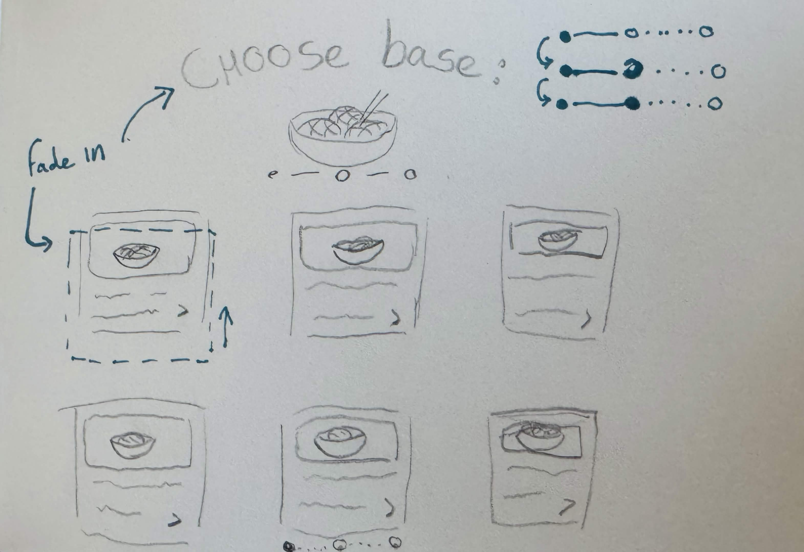
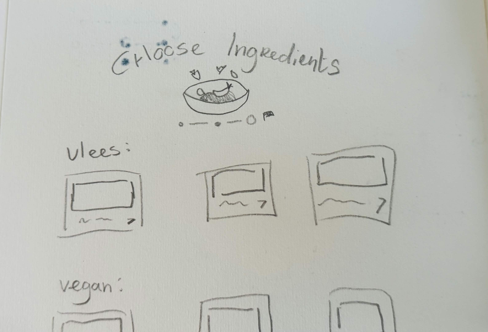
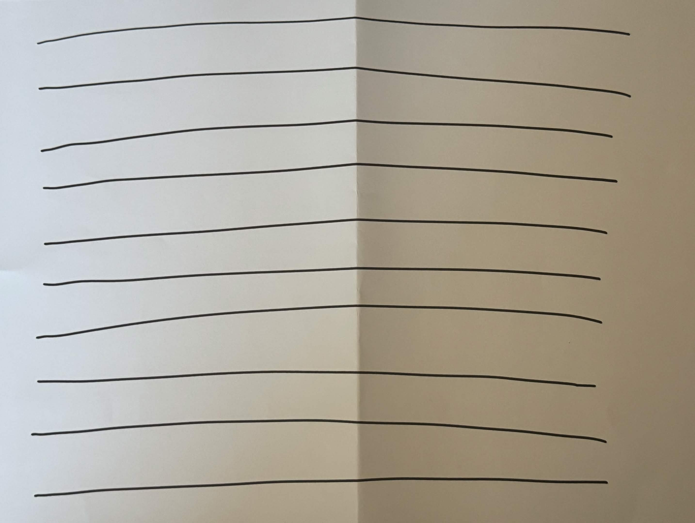
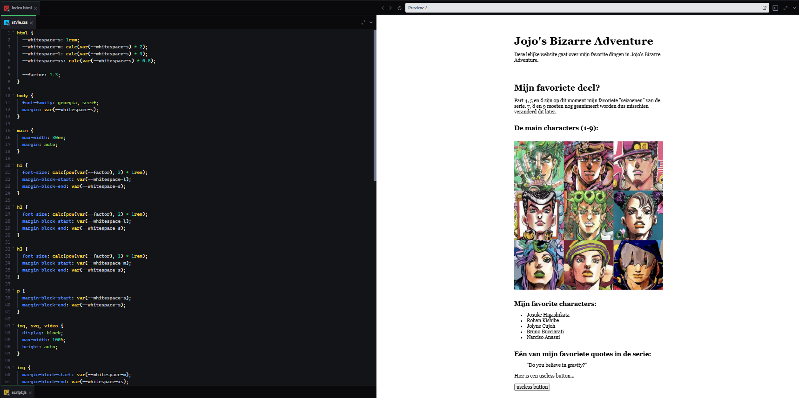
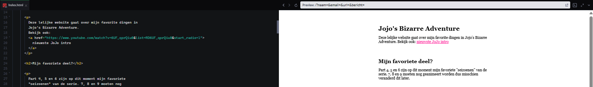
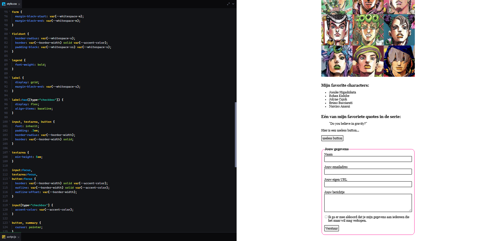

# Documentatie Het web is voor iedereen

## Deepdive Interactie Uitdaging Wok To Walk

Ik heb het formulier van Wok to Walk opnieuw ontworpen. Het doel was om het bestaand formulier om te zetten naar een gebruiksvriendelijke versie, Dit mocht door enkel te schetsen of iets uit te proberen in figma. Ik heb een beetje gekeken naar hoe andere restaurants dit hebben gedaan en met hulp daarvan een nieuw ontwerp gemaakt.

## Schets Practicum

In dit practicum heb ik geoefend met het schetsen van o.a. interactie en animatie. We hebben geoefend met het uit de losse pols rechte lijnen en gelijke vierkanten tekenen. Ook moesten we een mi-fi van een veel gebruikte website tekenen, ik koos voor Spotify.

Daarnaast hebben we geleerd hoe je animaties kunt schetsen met gebruik van verschillende kleuren, stippellijnntjes en annotaties.

## Deepdive Praktische CSS

_Voorbereiding deepdive._

_De HTML leesbaar maken._

_De HTML consistent en overzichtelijk maken._

_Interactief maken._

In dit practicum heb ik een lelijke HTML-website over JoJo's Bizarre Adventure steeds verder verbeterd met CSS. Eerst maakte we de leesbaarheid beter door de breedte van de pagina aan te passen en een ander lettertype te gebruiken. Ook hebben we witruimte toegevoegd en een duidelijke hiërarchie gemaakt tussen alle verschillende kopjes.

Vervolgens hebben we interactie toegevoegd aan de website. Ik heb een link toegevoegd en de hover aangepast. Ook heb ik een formulier toegevoegd met invoervelden een checkbox en een verstuurknop. Daarna hebben we die met CSS overzichtelijker gemaakt.

## Documentatie Sprint 1
