# _Documentatie Het web is voor iedereen_

# Documentatie Sprint 0

## Deepdive Interactie Uitdaging Wok To Walk

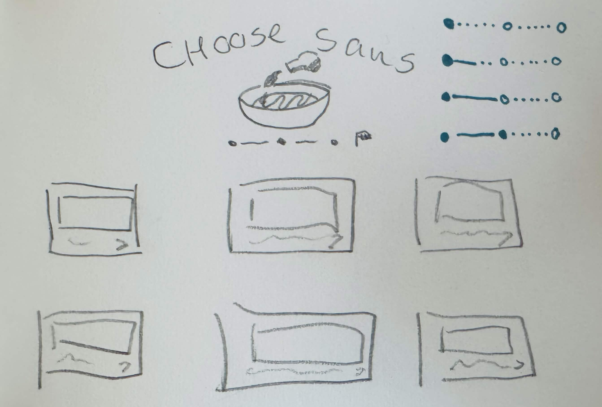
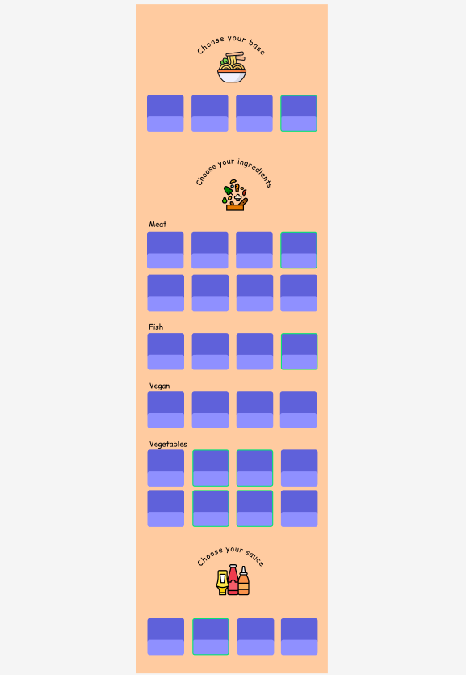

Ik heb het formulier van Wok to Walk opnieuw ontworpen. Het doel was om het bestaand formulier om te zetten naar een gebruiksvriendelijke versie, Dit mocht door enkel te schetsen of iets uit te proberen in figma. Ik heb een beetje gekeken naar hoe andere restaurants dit hebben gedaan en met hulp daarvan een nieuw ontwerp gemaakt.

## Schets Practicum

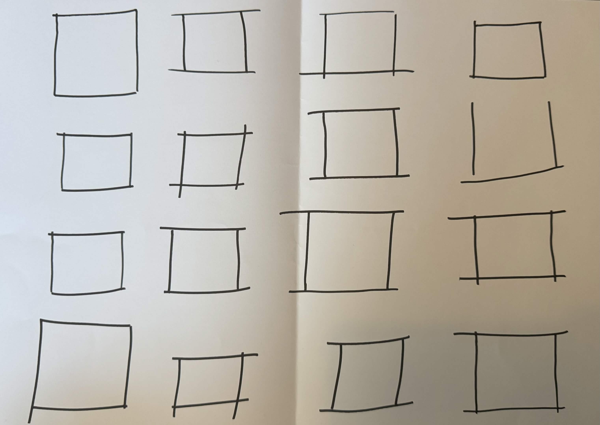

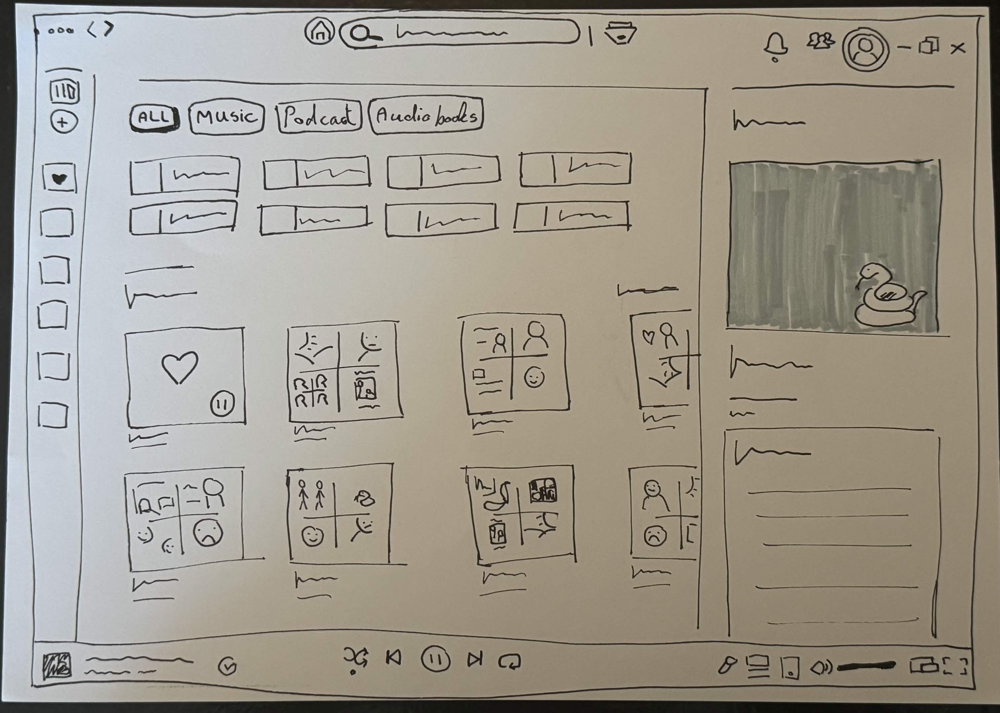

In dit practicum heb ik geoefend met het schetsen van o.a. interactie en animatie. We hebben geoefend met het uit de losse pols rechte lijnen en gelijke vierkanten tekenen. Ook moesten we een mi-fi van een veel gebruikte website tekenen, ik koos voor Spotify.

Daarnaast hebben we geleerd hoe je animaties kunt schetsen met gebruik van verschillende kleuren, stippellijnntjes en annotaties.

## Deepdive Praktische CSS

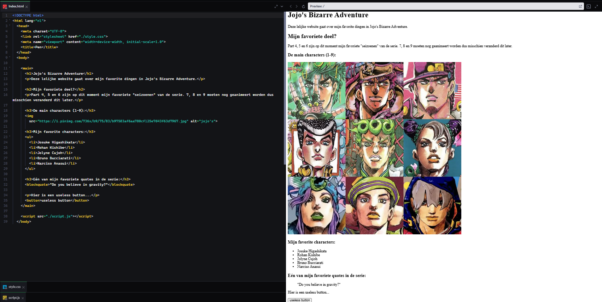
_Voorbereiding deepdive._

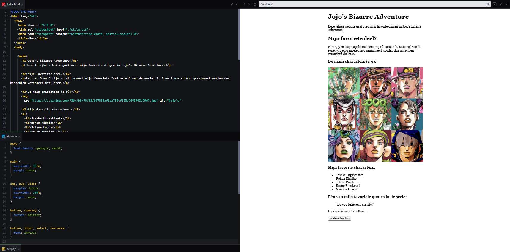
_De HTML leesbaar maken._

_De HTML consistent en overzichtelijk maken._

_Interactief maken._

In dit practicum heb ik een lelijke HTML-website over JoJo's Bizarre Adventure steeds verder verbeterd met CSS. Eerst maakte we de leesbaarheid beter door de breedte van de pagina aan te passen en een ander lettertype te gebruiken. Ook hebben we witruimte toegevoegd en een duidelijke hiërarchie gemaakt tussen alle verschillende kopjes.

Vervolgens hebben we interactie toegevoegd aan de website. Ik heb een link toegevoegd en de hover aangepast. Ook heb ik een formulier toegevoegd met invoervelden een checkbox en een verstuurknop. Daarna hebben we die met CSS overzichtelijker gemaakt.

# Documentatie Sprint 1

## Rangschik opdracht

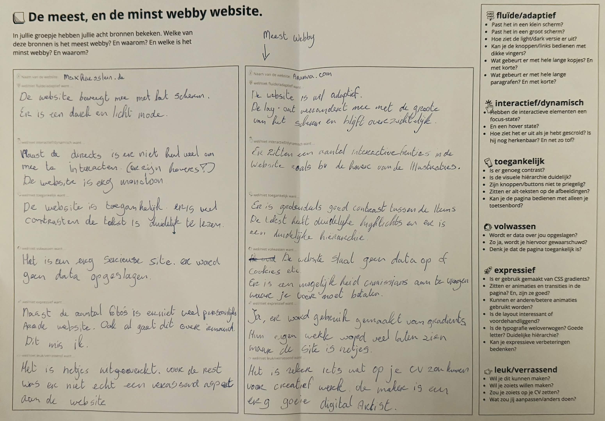

## Eigen verkenning

### Mijn onderwerp en inspiratie

Onderwerp:
Voor mijn Digital Garden heb ik als kern onderwerp gekozen voor JoJo's Bizarre Adventure. Dit is mijn favoriete serie en iets wat persoonlijk heel veel voor mij betekent. Ik wil mijn Digital Garden rondom deze serie bouwen omdat JJBA naar mijn mening veel meer is dan een simpele anime/manga. De creativiteit, interessante personages, muziek referenties, fashion en unieke artstyle maken JJBA voor mij echt uitzonderlijk.

Omdat de serie vol zit met referenties naar bekende artiesten, muzieknummers, bands, albums en modeontwerpers. Kan ik vanuit JJBA ook veel vertellen over andere dingen waar ik veel van houd en die mij erg inspireren. Daarnaast is tekenen één van mijn favoriete dingen om te doen en bewonder ik Hirohiko Araki (bedenker van JJBA) daar enorm in.

Mijn Digital Garden wordt dus niet alleen een website over JJBA maar een persoonlijke verzameling van mijn grootste interesses en inspiratie.

Wat wil ik zelf maken?
Voor de vormgeving van mijn Digital Garden wil ik een soort tijdschrift of modeblad ontwerpen. Ik vind de stijl van fashion magazines heel iconisch en interessant. Ze maken gebruik van grote titels, opvallende typografie, kleurrijke images en creatieve layouts. Dit past niet alleen erg goed bij JJBA maar je ziet bijvoorbeeld ook vaak bekende muziek artiesten op tijdschiften. Ik denk dat dit concept goed bij mijn onderwerp past.
Wat ik meeneem van de websites die ik heb bekeken is dat ik een website wil maken die echt een eigen sfeer en identiteit heeft. Ik vind het mooi om te zien hoe andere Digital Gardens allemaal echt een eigen persoonlijkheid hebben. Ik wil niet dat mijn website aanvoelt als een standaard informatieve website. Ik wil echt het gevoel van een creatief magazine overbrengen.

Ik wil bijvoorbeeld:
Een overzicht maken van mijn favoriete JJBA personages en hun musicale referenties.
Ontwerp keuzes en outfits van personages bespreken en koppelen aan de echte onderwerpen waar ze op gebaseert zijn.
Verschillende referenties en easter eggs laten zien.
Mijn eigen tekeningen, analyses en persoonlijke meningen laten zien.
Ik wil experimenteren met afbeeldingen, kleuren, typografie en stijlen combineren om een bepaalde samenhangende sfeer neer te zetten.

Het belangrijkste is wel dat mijn website niet alleen over JJBA gaat maar ook mijn eigen identiteit en persoonlijkheid laat zien. Ik wil dat de bezoekers het gevoel krijgen dat ze door een magazine bladeren en steeds meer ontdekken over mijn favoriete dingen.

## Verzameling inspiratie

Op dit pintrest bord vind je veel verschillende afbeeldingen die ik als inspiratie wil gebruiken voor mijn Digital Garden.
https://pin.it/DcgZNnuZB

### styleguide onepager

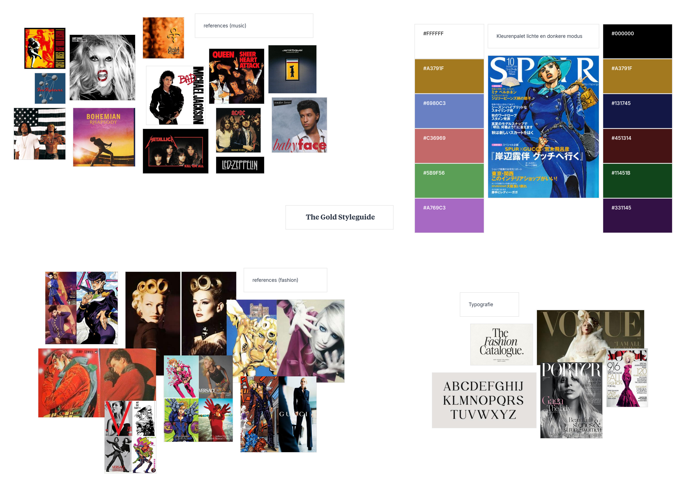

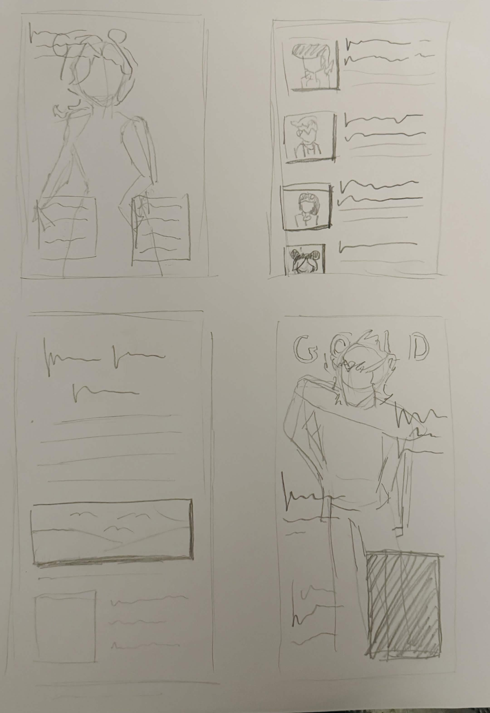

### Hi-Fi Figma ontwerp

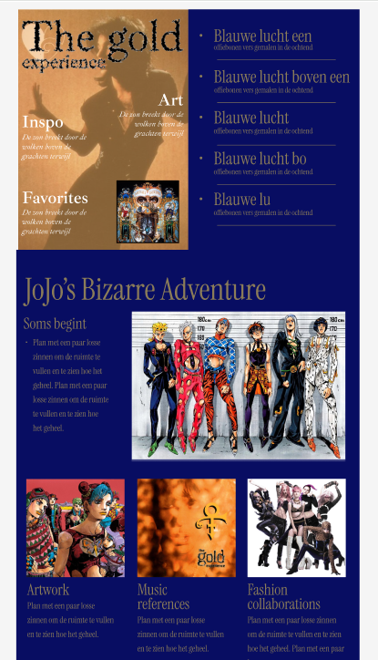
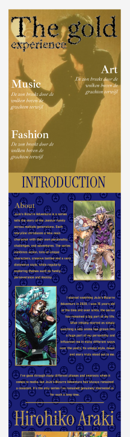
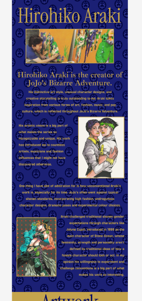
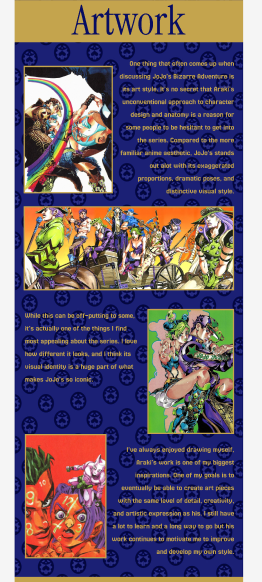
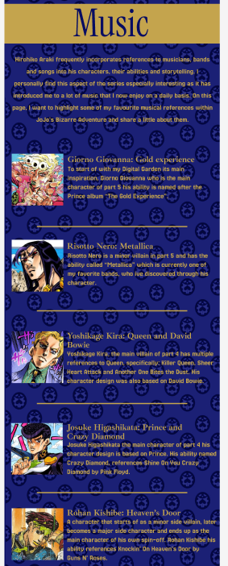

### Process HTML CSS

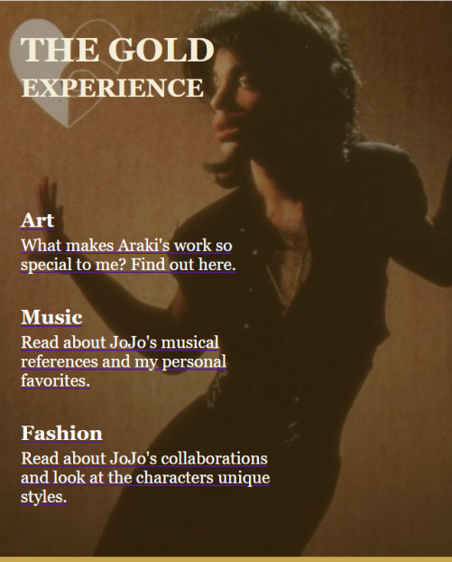
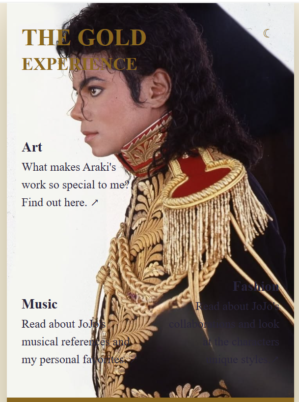
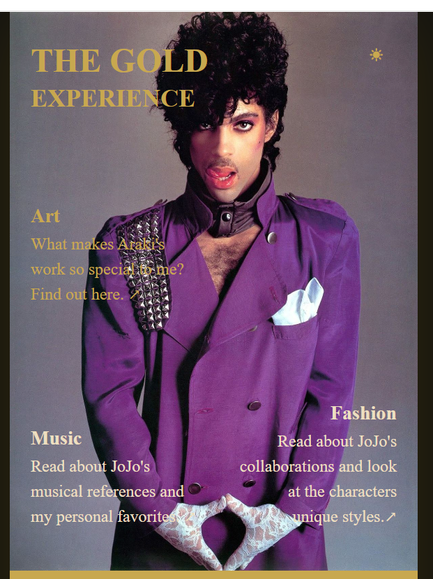
